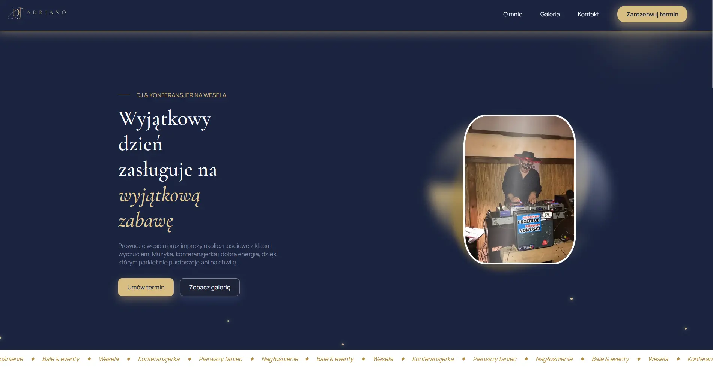

<p align="center">
  <picture>
    <source media="(prefers-color-scheme: dark)" srcset="docs/header-dark.svg">
    
  </picture>
</p>

<h3 align="center">A one-page website for a wedding DJ & host</h3>

<p align="center">
  <br>
  A promotional site for <b>Adriano</b>, a DJ and host for weddings and special events.
  <br>
  Fast and fully static: no frameworks, no build step, just clean HTML and CSS.
  <br><br>
</p>

<p align="center">
  <a href="https://adrianodj.pl"></a>
</p>


### 📸 Preview




### ✨ Features


#### 🧭 Single-page layout
Smooth in-page navigation between **About**, **Gallery** and **Contact**.

#### 📱 Responsive design
Adapts from desktop down to mobile, with a **hamburger menu** on small screens.

#### ♿ Accessibility-minded
**Semantic HTML**, ARIA labels, and alt text on media.

#### 🎬 Promo video and gallery
A **promo video** and an image gallery showcasing events.

#### ✉️ Contact section
Direct **email**, **phone**, and a reservation call-to-action.

#### 🧩 PWA basics
**Favicons** and a **web manifest** for a polished look on all devices.

### 🛠️ Tech stack


| Category | Stack |
|---|---|
| **Markup** |  semantic, hand-written markup |
| **Styles** |  custom styles with CSS variables (no framework) |
| **Fonts** |  Cormorant Garamond & Manrope |
| **Hosting** |   |

### 🗂️ Project structure


```
DJ-site/
├── index.html          # The page markup
├── dj-site.css         # All styles
├── site.webmanifest    # PWA manifest
├── assets/             # Logo, photos, promo video
├── docs/               # README graphics
└── icons/              # UI icons and favicons
```

### 🚀 Running locally


No build tools or dependencies are required.

**1. Get the files**: clone the repo (or download it as a ZIP).

```bash
git clone https://github.com/majkab8/DJ-site.git
cd DJ-site
```

**2. Open the site**, either:

- **Directly:** double-click `index.html` to open it in your browser, or
- **Serve locally** (recommended, so paths behave like production):

```bash
# Python 3
python -m http.server 8000
```

Then visit http://localhost:8000.

### ☁️ Deployment


The site is deployed on [Vercel](https://vercel.com) and served from the custom domain **adrianodj.pl**. Any push to the `main` branch triggers an automatic redeploy.

### 💬 Contact


- **Bookings & enquiries for the DJ**: see the contact section on the [live site](https://adrianodj.pl).
- **Questions about this website or its code**: reach out via [GitHub](https://github.com/majkab8).

### 📜 License


© 2026 DJ Adriano. All rights reserved.
This code is published for portfolio purposes only and may not be reused, copied, or redistributed without permission.
